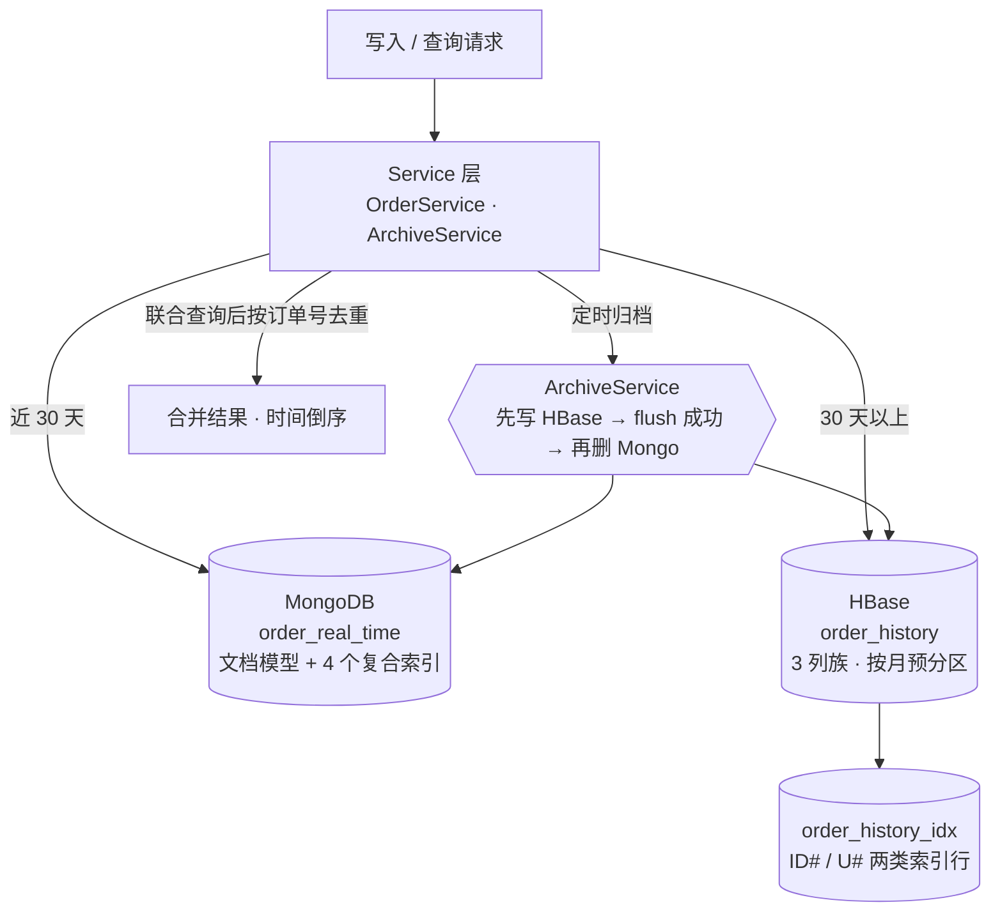

# 海量电商订单混合存储：HBase 离线存储 + MongoDB 实时检索

用 **30 天**做冷热分界，把电商订单拆到两个引擎里各做擅长的事：**MongoDB** 承接近 30 天的点查与聚合，**HBase** 承接 30 天以上的长期留存与按时间范围扫描，中间用定时归档任务把冷数据搬过去 —— 用户视角仍然是「一个完整的订单列表」。

> 一条数据只在一个库里有"归属"，但查询侧要拼出完整结果集，这就是混合存储真正要解决的问题。

---

## 架构



**为什么这样分工**

| | MongoDB | HBase |
|---|---|---|
| 强项 | 单条点查、多条件组合过滤、服务端聚合（`$group`） | 按 RowKey 顺序的连续区间扫描、海量长期留存 |
| 弱项 | 数据量涨到亿级后索引与内存成本高 | 无二级索引（除非自建）、无服务端求和 |
| 承担的查询 | 按用户 / 按状态 / 按时间+商品 / 近 7 天聚合 | 按订单号点查 / 按时间范围扫描 / 按月统计 / 按用户取历史 |

---

## 四个关键设计

### 1. 行键：19 位倒序毫秒时间戳 + 订单号

```java
// 把毫秒时间戳转成定长 19 位的倒序时间戳字符串
public static String reverseTs(long epochMilli) {
    return String.format("%019d", Long.MAX_VALUE - epochMilli);
}

// 主表 order_history 的行键
public static String mainRowKey(String orderId, Date orderTime) {
    return reverseTs(orderTime.getTime()) + "|" + orderId;
}

// 计算时间范围扫描的起止行键（左闭右开）
// 注意：倒序时间戳下，时间越晚值越小，因此起点是 to、终点是 from。
public static String[] timeRange(Date from, Date to) {
    return new String[]{
            reverseTs(to.getTime()),                 // 起点：含 to
            reverseTs(from.getTime()) + "\uFFFF"     // 终点：覆盖 from 这一毫秒的全部订单
    };
}
```

设计收益：**字典序 = 时间倒序**，同月订单在物理上连续存放，按月扫描退化成顺序 IO；「最新优先」不需要反向 Scan；`\uFFFF` 收敛到毫秒级开区间，避免漏掉同一毫秒的多笔订单。

### 2. 二级索引表：补上"按订单号点查"

主表 RowKey 以时间开头，就无法直接 `Get(orderId)`。用一张单列族索引表 `order_history_idx` 存两类行，靠前缀区分：

| 索引行 RowKey | 用途 |
|---|---|
| `ID#<orderId>` | 按订单号反查主表 RowKey（1 次 RPC 变 2 次） |
| `U#<userId>#<reverseTs>#<orderId>` | 按用户取全部历史订单（前缀 Scan） |

主表与索引写在**同一个批量提交**里（先主表、后索引），归档任务必须两者都 `flush()` 成功才允许删除 MongoDB 中的源数据 —— 否则会出现"主表有、索引没有"的隐蔽不一致。

### 3. 列族与预分区

- 3 个列族：`info`（基础）/ `pay`（支付）/ `logistics`（物流），按访问模式分组 —— 只做支付聚合的查询不必读物流地址列；
- `VERSIONS=1`（订单是"最后写入为准"的更新型数据）、`TTL=FOREVER`（历史订单要长期留存用于对账审计）；
- 按月份边界预分区（演示环境 35 个 Region），避免写入期热点 Split。

> 压缩算法取 `NONE`：本机 Hadoop native 库没编译 Snappy（`hadoop checknative` 无 snappy 项），设 `SNAPPY` 会在刷盘时抛 `UnsatisfiedLinkError` 并让 RegionServer 反复 abort。换到支持 native Snappy 的环境，把 `HBaseUtil` 里 4 处 `Compression.Algorithm.NONE` 改回 `SNAPPY` 即可。

### 4. 归档顺序不能反

```
findExpired → 写入 HBase → flush 成功 → 才允许 deleteMany(MongoDB)
```

先删后写，中途失败就是**永久丢数据**；先写后删，靠 HBase Put 的覆盖语义保证重跑幂等。分界 `archive.cutoff.days=30`，归档是滚动过程而非一次性批处理 —— 这也是用 `ScheduledExecutorService` 而不是 `Timer` 的原因：单次失败不能杀死调度。

---

## 实测数据

单机伪分布式、Ubuntu 虚拟机、10 万条订单（实时 55,457 条 → MongoDB，历史 44,543 条 → HBase，索引表 89,086 行）。

### 写入

| 引擎 | 条数 | 耗时 | 吞吐 |
|---|---|---|---|
| MongoDB（批次 5,000，`ordered(false)`） | 55,457 | 1,330 ms | ≈ 41,700 条/秒 |
| HBase（`BufferedMutator` 8 MB，索引批 2,000） | 44,543 | 3,540 ms | ≈ 12,600 条/秒 |

HBase 慢约 **2.7 倍**，代价来自写放大：每条订单写 3 行（主表 1 + 索引 2），再加 WAL 与 MemStore。

### 查询

| 查询 | 耗时 | 返回 |
|---|---|---|
| M1 按 userId 查实时订单 | 10 ms | 1 条 |
| M2 按状态查（limit 200） | 29 ms | 200 条 |
| M3 近 30 天 + 商品 ID | 164 ms | 4,930 条 |
| M4 近 7 天各状态订单数与金额（`$group`） | 49 ms | 5 种状态 / 13,310 笔 |
| H1 按 orderId 查详情（走索引表） | 9 ms | 1 条 |
| H2 扫描 90 天历史订单 | 162 ms | 3,928 条 |
| H3 统计指定月份总量与金额 | 22 ms | 2,562 笔 |
| H4 按 userId 批量取历史 | 95 ms | 4 条 |

### Scan 缓存行数对照（90 天、只读单个列族）

| caching | 10 | 100 | 500 | 2,000 |
|---|---|---|---|---|
| 耗时 | 659 ms | 183 ms | 74 ms | 69 ms |

从 10 提到 500 降了 **89%**，再提到 2,000 只再降 7% 却要多 4 倍客户端内存 —— 拐点在 500，故默认取 500。

### 双库协同

- 归档 5,001 条 / 3 批 / **886 ms**，迁移前后两库总量守恒；
- 联合查询（某用户 1 条实时 + 3 条历史）合并 4 条 / **74 ms**，按时间倒序、无重复。

---

## 技术栈

- Java 8、Maven（显式声明 surefire 3.2.5 以支持 JUnit 5）
- HBase Client 2.5.8、MongoDB Java Driver 5.2.1
- Hadoop 3.3.6（HDFS 作为 HBase rootdir）、ZooKeeper 3.6.3
- 单机伪分布式部署（一台 Ubuntu 虚拟机）

## 目录结构

```
src/main/java/com/lab/order/
├── entity/   Order  Goods  Address  OrderStatus
├── util/     RowKeyUtil  HBaseUtil  MongoUtil
│             OrderGenerator  OrderFileStore  OrderConverter
│             OrderImporter  Timer
├── dao/      OrderMongoDao  OrderHBaseDao
└── service/  OrderService  ArchiveService

src/test/java/com/lab/order/test/
    HBaseUtilTest  MongoUtilTest  DataGenTest
    ImportTest  MongoQueryTest  HBaseQueryTest  ArchiveServiceTest
```

分层职责：实体层对应文档结构 → 工具层封装底层客户端 → DAO 层按存储引擎拆开 → Service 层做双库路由与业务编排 → 测试层验证行为与耗时。

---

## 结论（也是踩过的坑）

1. **行键设计决定 HBase 性能**：把时间放进 RowKey 前缀，范围扫描才可能变成连续区间读；"倒序"顺手拿到"最新优先"。
2. **索引命中不等于快**：M3 走了 `IXSCAN` 仍要 164 ms，因为命中 4,930 条，时间花在回表与 BSON 反序列化上 —— 快慢最终由返回行数决定，不是由索引是否存在决定。
3. **HBase 没有服务端求和**：按月统计要么拉回客户端累加（本项目），要么用 Coprocessor Endpoint 下推，要么换 ClickHouse/Phoenix 这类引擎。
4. **混合存储的收益有量级前提**：10 万条规模下两库都在毫秒级，真正的收益是把「长期留存」与「实时点查」两种相反需求分开承接，而不是绝对耗时。
5. **代价**：两库之间没有强一致，靠"先写后删 + Put 幂等 + 查询侧去重"三件套弥补；运维上多一套集群。

---

## 仓库说明

本仓库为**项目展示**：包含架构设计、行键与索引方案、实测性能数据与核心代码片段，另附完整的数据模型设计文档（`docs/数据模型设计文档.md`，含表结构、列族、索引与字段映射）。

完整实现（Java 源码 + 7 个测试类 + 建表/导入/基准测试脚本）保留在私有仓库中，如需查看请联系我。

## 已知限制

- 数据为程序生成（固定随机种子 + 业务规则联动），10 万条、单机伪分布式，结论只在这个量级成立；
- 商品维度的高频查询交给了 MongoDB，HBase 侧只有时间维度索引；若要按商品查 HBase，需要再加 `G#<goodsId>#<reverseTs>#<orderId>` 索引表或引入 Elasticsearch；
- 归档为定时轮询，没有事件驱动（Change Stream）与断点续传；
- 未做并发压测与可观测性（指标、慢查询日志）。